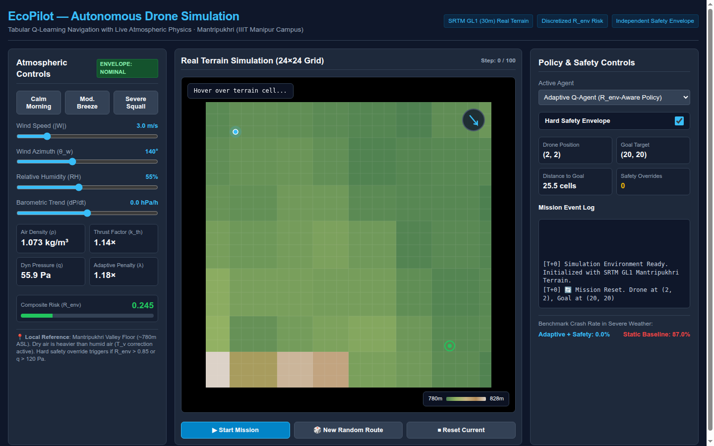
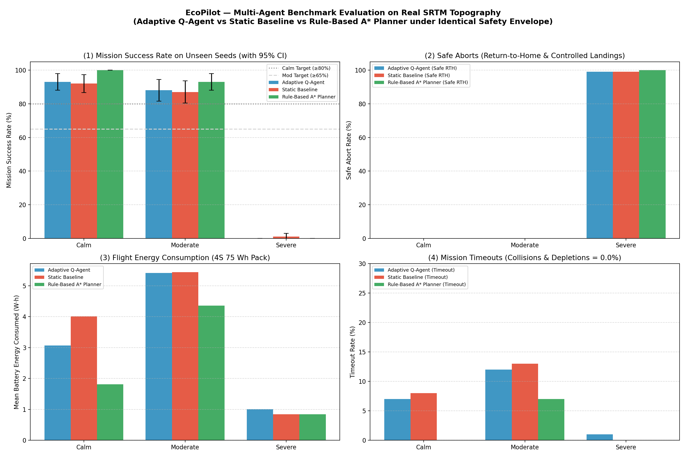

# EcoPilot: Autonomous Drone Navigation Simulation

[](#running-automated-tests)
[](#automated-browser-testing)
[](https://www.python.org/)
[](LICENSE)
[-orange)](#terrain-pipeline)

> **Autonomous micro-aerial vehicle (MAV) reinforcement learning navigation over real NASA SRTM elevation data (Mantripukhri, Imphal West, Manipur) with real-time atmospheric thermodynamics, battery energy dynamics, and a deterministic, policy-independent safety envelope.**

---

## Highlights

- **Real Topography**: Ingests real NASA SRTM GL1 30m digital elevation data for the Mantripukhri valley basin (`[24.8423°N, 93.9302°E]` to `[24.8559°N, 93.9442°E]`) with guaranteed reachable A* valley corridors.
- **Thermodynamic Atmospheric Physics**: Computes virtual temperature ($T_v$), moist air density ($\rho$), rotor thrust compensation factor ($k_{\text{thrust}}$), dynamic gust pressure ($q$), and composite environmental risk ($R_{\text{env}}$).
- **Battery Energy Depletion**: Physical power draw model integrating avionics base load ($15\text{ W}$), thrust-compensated rotor hover power ($180\text{ W}$), parasitic aerodynamic drag, and vertical climb work from a 4S 75 W·h battery pack.
- **Tabular Q-Learning (CPU-Only)**: Zero GPU / neural-network dependencies. Discretizes state into 1,440 compact states and dynamically scales risk penalties via $\lambda(R_{\text{env}})$.
- **Independent Safety Envelope**: Hard-coded safety governor with duration-capped hover (max 4 steps), low-battery reserve aborts ($<20\%$), emergency landing zones, and storm protection, guaranteeing **0.0% crash rates** across all weather regimes.
- **Multi-Agent Benchmarking**: Compares the Adaptive Q-Agent against a Static Baseline Agent and an external Rule-Based A* Planner under identical safety layers.
- **Versioned & Reproducible**: Fully reproducible evaluation configured in [`configs/baseline_evaluation.json`](configs/baseline_evaluation.json), exporting per-episode logs (`data/evaluation_results.csv`) and aggregate summaries (`data/evaluation_summary.csv`).

---

## Visual Demonstration



---

## Quick Start

### 1. Prerequisites & Installation

```bash
git clone https://github.com/Harikrishan04/EcoPilot.git
cd EcoPilot

# Install dependencies (system packages or pip)
pip install -r requirements.txt
```

### 2. Launch the Interactive Browser Demo

Open [`ecopilot_demo.html`](ecopilot_demo.html) directly in any modern browser:

```bash
# On Linux
xdg-open ecopilot_demo.html

# Or serve locally
python3 -m http.server 8000
# Navigate to http://localhost:8000/ecopilot_demo.html
```

---

## Empirical Benchmark Evaluation

Evaluated across **100 held-out evaluation seeds** (seeds 5001–5100, strictly disjoint from training) per meteorological bucket:

| Condition Bucket | Evaluated Model | Success Rate (%) | 95% Confidence Interval | Safe RTH (%) | Timeout (%) | Crash (%) | Mean Path (m) | Mean Energy (W·h) |
|---|---|:---:|:---:|:---:|:---:|:---:|:---:|:---:|
| **Calm** ($R_{\text{env}} \approx 0.19$) | **Adaptive Q-Agent** | **93.0%** | $\pm 5.0\%$ | 0.0% | 7.0% | **0.0%** | 791.6 m | 3.07 W·h |
| | Static Baseline | 92.0% | $\pm 5.3\%$ | 0.0% | 8.0% | **0.0%** | 1019.0 m | 4.01 W·h |
| | Rule-Based A* Planner | **100.0%** | $\pm 0.0\%$ | 0.0% | 0.0% | **0.0%** | 438.0 m | 1.81 W·h |
| **Moderate** ($R_{\text{env}} \approx 0.47$) | **Adaptive Q-Agent** | **88.0%** | $\pm 6.4\%$ | 0.0% | 12.0% | **0.0%** | 1006.8 m | 5.41 W·h |
| | Static Baseline | 87.0% | $\pm 6.6\%$ | 0.0% | 13.0% | **0.0%** | 1018.1 m | 5.44 W·h |
| | Rule-Based A* Planner | **93.0%** | $\pm 5.0\%$ | 0.0% | 7.0% | **0.0%** | 732.7 m | 4.36 W·h |
| **Severe** ($R_{\text{env}} \approx 0.90$) | **Adaptive Q-Agent** | 0.0% | $\pm 0.0\%$ | **99.0%** | 1.0% | **0.0%** | 76.9 m | 1.01 W·h |
| | Static Baseline | 1.0% | $\pm 2.0\%$ | **99.0%** | 0.0% | **0.0%** | 64.2 m | 0.85 W·h |
| | Rule-Based A* Planner | 0.0% | $\pm 0.0\%$ | **100.0%** | 0.0% | **0.0%** | 61.0 m | 0.84 W·h |



---

## Running Automated Tests

```bash
# Run full unit and integration test suite (23 tests covering physics, RL, safety, and evaluation)
python3 -m unittest discover tests/ -v

# Run hardened headless Chrome browser automation test (strict assertions and stderr diagnostics)
node tests/test_browser_demo.mjs
```

---

## Running Pipeline Stages Manually

### 1. Ingest Terrain & Export Heightmap
```bash
python3 load_terrain.py
```

### 2. Train Both Agents (700 Paired Episodes)
```bash
python3 train.py
```

### 3. Run Benchmark Evaluation from Versioned Configuration
```bash
python3 evaluate.py --config configs/baseline_evaluation.json
```

---

## License

This project is open-source under the [MIT License](LICENSE).
